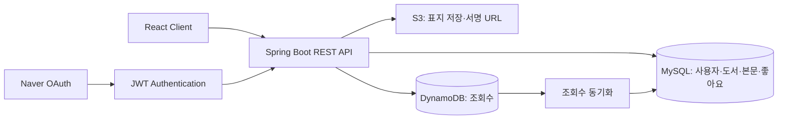

# 모두의 서재 · Backend

**도서 API부터 인증·권한, 클라우드 배포 연동까지 연결한 Spring Boot 백엔드 포트폴리오**

사용자가 글을 등록하고, AI로 만든 표지를 선택해 한 권의 도서로 공개하는 창작 플랫폼입니다.
KT AIVLE 4·5차 팀 프로젝트에서 **김건우는 도서 등록·목록·인기 조회 API, Validation, 좋아요 데이터 모델, JWT·작성자 인가 개선 및 배포 연동 설정**을 담당했습니다.

[Frontend](https://github.com/withoutsultang/aivle-library-frontend) · [개인 기여](docs/CONTRIBUTIONS.md) · [설계](docs/ARCHITECTURE.md) · [실행](docs/RUNNING.md) · [검증](docs/VERIFICATION.md)

## 핵심 성과

|역량|구현과 결과|살펴볼 코드|
|---|---|---|
|API 계약 설계|Controller–Service–Repository를 연결하고 요청·응답 DTO와 페이지 응답을 구성|[BookController](src/main/java/com/aivle8/backend/controller/BookController.java)|
|사용자 데이터 보호|JWT 사용자 ID를 서비스에 전달하고 작성자 확인 후 도서를 수정·삭제|[BookServiceImpl](src/main/java/com/aivle8/backend/service/BookServiceImpl.java)|
|일관된 오류 처리|입력 검증 오류와 비즈니스 예외를 상태 코드·메시지로 전달|[GlobalExceptionHandler](src/main/java/com/aivle8/backend/global/exception/GlobalExceptionHandler.java)|
|탐색과 도메인 모델링|조회수 기반 상위 N개 조회, BookLike 유니크 제약과 관계 모델|[BookRepository](src/main/java/com/aivle8/backend/repository/BookRepository.java) · [BookLike](src/main/java/com/aivle8/backend/domain/BookLike.java)|
|배포 환경 연동|health endpoint·CORS·OAuth redirect·RDS·SSM 설정 연결|[SecurityConfig](src/main/java/com/aivle8/backend/security/SecurityConfig.java) · [시작 스크립트](scripts/start.sh)|

## 서비스 구조



서비스 전반은 팀이 함께 구현했습니다. 본인의 API·인증·모델·배포 연동 기여와 팀의 스토리지·조회수·인프라 구성을 [기여 문서](docs/CONTRIBUTIONS.md)에 구분했습니다.

## 포트폴리오 고도화

개인 공개본에서는 **인증·이미지·배포의 경계 조건을 테스트로 확인할 수 있는 코드**로 발전시켰습니다.

- 도서 생성 응답에 HTTP `201 Created` 적용
- 도서 표지의 저장 key와 접근 URL 분리, 서명 URL을 통한 조회
- 새 이미지 저장 후 교체, 기존 이미지 재선택 시 저장 key 유지
- 서버에서 AI 표지 생성 요청을 처리하고 PNG 응답을 S3 저장 흐름으로 연결
- DynamoDB 페이지 전체를 순회하는 조회수 동기화
- 설정 가능한 CORS·리전·테이블·이미지 출처와 HTTP 200 기반 배포 상태 검사
- Java 테스트·패키징을 검증하는 CI 구성

## 기술 스택

|영역|기술|
|---|---|
|Backend|Java 17 · Spring Boot 3.5.8 · Spring Web · Spring Data JPA|
|Security|Spring Security · JWT · Naver OAuth|
|Data & Cloud|MySQL · AWS S3 · DynamoDB · EC2 · CodeDeploy · Parameter Store|
|Quality|Gradle Wrapper · JUnit 5 · Mockito · GitHub Actions|

## 빠른 시작

```bash
git clone https://github.com/withoutsultang/aivle-library-backend.git
cd aivle-library-backend
./gradlew test bootJar
```

Windows에서는 `.\gradlew.bat test bootJar`를 사용합니다.
API 서버 실행은 JDK 17, MySQL과 본인 AWS·네이버 설정을 준비한 뒤 `./gradlew bootRun`으로 시작합니다.
환경변수 목록은 [.env.example](.env.example), 상세 절차는 [실행 가이드](docs/RUNNING.md)를 참고하세요.

## 탐색 가이드

- [개인 기여와 커밋 근거](docs/CONTRIBUTIONS.md)
- [데이터·인증·배포 설계](docs/ARCHITECTURE.md)
- [API 목록](docs/API.md)
- [테스트·빌드 검증](docs/VERIFICATION.md)
- [제3자 자료와 출처](docs/THIRD_PARTY.md)

**김건우 · [GitHub](https://github.com/withoutsultang)** | KT AIVLE 팀 프로젝트 기반 개인 포트폴리오
