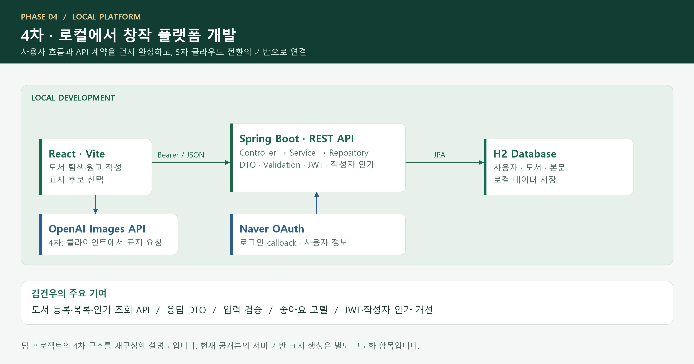
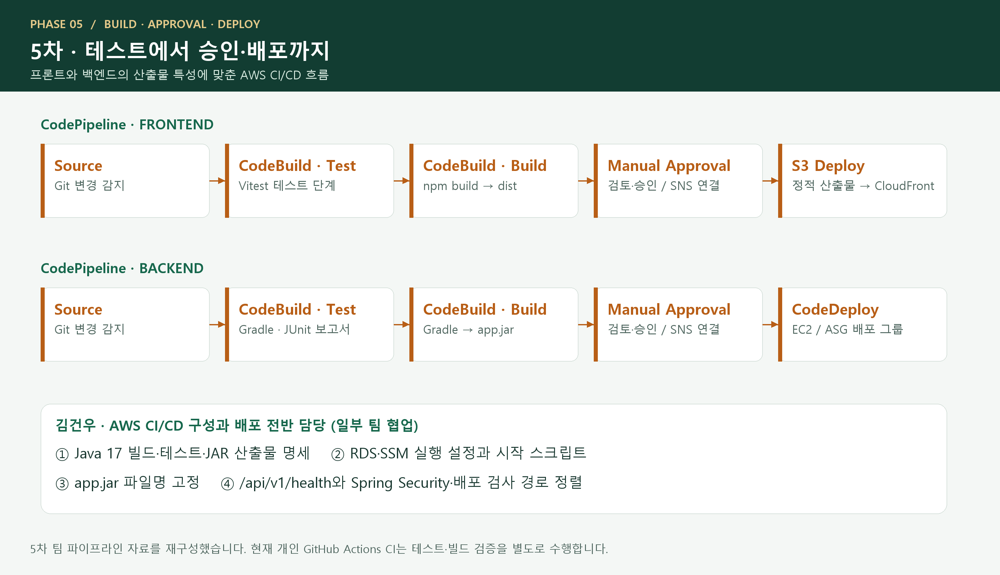

# 모두의 서재 · Backend

**4차에는 로컬 창작 플랫폼을 개발하고, 5차에는 AWS 인프라·배포·환경 구성으로 확장한 프로젝트**

글을 작성하고 AI 표지를 선택해 한 권의 책으로 공개하는 KT AIVLE 4·5차 팀 프로젝트입니다.
김건우는 **4차 백엔드 API·데이터 계약·인증/인가 개선**, **5차 AWS 구축·환경 설정·배포 전반**을 담당했습니다. 일부 AWS 작업은 팀원과 공동 수행했습니다.

[Frontend](https://github.com/withoutsultang/aivle-library-frontend) · [개인 기여](docs/CONTRIBUTIONS.md) · [AWS 구성](docs/AWS_DEPLOYMENT.md) · [설계](docs/ARCHITECTURE.md) · [실행](docs/RUNNING.md) · [검증](docs/VERIFICATION.md)

## 두 단계로 확장한 프로젝트

|단계|중심 과제|김건우의 주요 역할|
|---|---|---|
|**4차 · 로컬 플랫폼 개발**|React–Spring Boot–H2로 사용자 흐름과 API 구현|도서 등록·목록·인기 조회, DTO·Validation, 좋아요 모델, JWT·작성자 인가 개선|
|**5차 · AWS 배포·환경 구성**|개발한 서비스를 클라우드 실행·배포 환경으로 전환|AWS 인프라·환경 설정·배포 전반 담당, CI/CD와 RDS·SSM·OAuth·CORS·health 연동|

## 4차 · 로컬에서 모두의 서재 개발



|역량|직접 구현·개선한 내용|살펴볼 코드|
|---|---|---|
|API 계약 설계|도서 등록·목록 API, 요청·응답 DTO, 페이지 응답 구성|[BookController](src/main/java/com/aivle8/backend/controller/BookController.java)|
|입력 검증|Validation 오류를 공통 메시지·상태 코드로 전달|[GlobalExceptionHandler](src/main/java/com/aivle8/backend/global/exception/GlobalExceptionHandler.java)|
|데이터 모델링·탐색|조회수 기반 상위 N개 조회, BookLike 관계·유니크 제약|[BookRepository](src/main/java/com/aivle8/backend/repository/BookRepository.java) · [BookLike](src/main/java/com/aivle8/backend/domain/BookLike.java)|
|인증·인가 개선|JWT 사용자 ID 전달, 작성자 확인 후 도서 수정·삭제|[BookServiceImpl](src/main/java/com/aivle8/backend/service/BookServiceImpl.java)|

React 화면·네이버 로그인·AI 표지·도서 API를 연결한 서비스 전체는 팀의 공동 결과물입니다. 개인 기여는 [작성 커밋](docs/CONTRIBUTIONS.md)으로 구체화했습니다.

## 5차 · AWS 배포와 환경 구성

4차의 로컬 서비스를 AWS에서 배포·실행하는 환경으로 확장했습니다. **김건우는 AWS 인프라 구성·환경 설정·배포 전반을 담당했고, 일부 작업은 팀원과 공동 수행했습니다.** 프론트엔드와 백엔드를 각각 배포하면서 네트워크·권한·데이터·실행 설정·배포 파이프라인을 함께 연결했습니다.


|구성 영역|AWS 구성과 연결|프로젝트에서 만든 결과|
|---|---|---|
|웹 전달·API 라우팅|CloudFront · S3 · ALB|정적 화면과 `/api/v1/*` 요청을 각 origin으로 분리|
|애플리케이션 실행|VPC · EC2 · Auto Scaling Group · Target Group|여러 인스턴스로 Spring Boot를 실행하고 ALB health 경로와 연결|
|데이터 저장|RDS MySQL · S3 · DynamoDB|사용자·도서 데이터, 표지 객체, 조회수 저장을 외부 서비스로 분리|
|실행 설정·권한|SSM Parameter Store · IAM 역할|배포 서비스와 실행 환경을 연결하고 DB·JWT·OAuth 설정을 앱에 주입|
|배포·운영 관측|CodePipeline · CodeBuild · CodeDeploy · SNS · CloudWatch|테스트·빌드·승인·배포 단계와 지표·로그 관측 환경 구성|

### CI/CD 구성



프론트엔드는 테스트·빌드 후 정적 산출물을 S3에 배포하고, 백엔드는 JAR를 생성해 CodeDeploy로 EC2 배포 그룹에 전달합니다. 수동 승인과 SNS를 연결하고 CloudWatch 지표·로그로 실행 환경을 확인하는 흐름을 구성했습니다.

자세한 구성과 기여 근거는 [AWS 배포·환경 구성](docs/AWS_DEPLOYMENT.md), [개인 기여](docs/CONTRIBUTIONS.md)에서 확인할 수 있습니다. 이미지는 5차 팀 코드·콘솔 자료를 재구성한 설명도이며, 인스턴스 개수는 구조를 보여주기 위한 예시입니다.

## 개인 공개본 고도화 · 2026년 10월

4·5차 프로젝트 이력을 바탕으로 현재 공개본에는 다음 개선을 추가했습니다.

- 도서 생성 HTTP `201 Created`, 기존 표지 유지와 새 표지 저장 후 교체
- 서버 기반 AI 표지 생성, S3 key와 서명 URL 분리, PNG 입력 검증
- DynamoDB 전체 페이지 순회, 설정 가능한 CORS·리전·테이블
- HTTP 200 기반 상태 검사와 필수 설정 확인 후 시작하는 배포 스크립트
- **백엔드 테스트 26개 통과**, 테스트·JAR 패키징 GitHub Actions CI

## 기술 스택

|구분|기술|
|---|---|
|4차 개발|Java 17 · Spring Boot 3.5.8 · Spring Data JPA · Spring Security · JWT · H2 · Naver OAuth|
|5차 AWS|VPC · EC2 · ALB · ASG · RDS MySQL · S3 · CloudFront · DynamoDB · SSM · IAM|
|5차 배포·관측|CodePipeline · CodeBuild · CodeDeploy · SNS · CloudWatch|
|현재 품질 관리|Gradle Wrapper · JUnit 5 · Mockito · GitHub Actions|

## 빠른 시작

```bash
git clone https://github.com/withoutsultang/aivle-library-backend.git
cd aivle-library-backend
./gradlew test bootJar
```

Windows에서는 `.\gradlew.bat test bootJar`를 사용합니다. 현재 서버는 MySQL·AWS·네이버 환경변수를 설정한 뒤 `./gradlew bootRun`으로 실행합니다.
변수 목록은 [.env.example](.env.example), 상세 절차는 [실행 가이드](docs/RUNNING.md)에 정리했습니다.

## 더 살펴보기

- [4차·5차 개인 기여와 커밋 근거](docs/CONTRIBUTIONS.md)
- [AWS 배포·환경 구성 상세](docs/AWS_DEPLOYMENT.md)
- [애플리케이션 설계](docs/ARCHITECTURE.md) · [API 목록](docs/API.md)
- [검증 기록](docs/VERIFICATION.md) · [제3자 자료와 출처](docs/THIRD_PARTY.md)

**김건우 · [GitHub](https://github.com/withoutsultang)** | KT AIVLE 팀 프로젝트 기반 개인 포트폴리오
