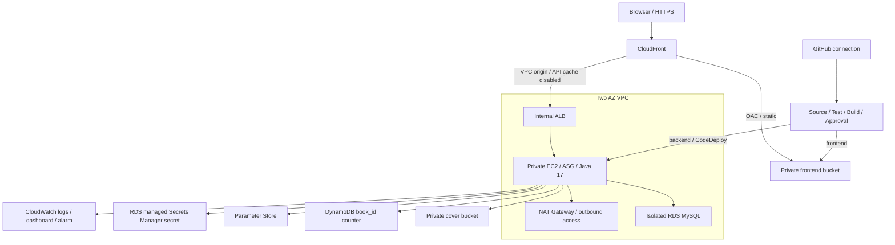

# 모두의 서재 · 재현 가능한 AWS 인프라

**개인 공개본 고도화 · 2026-11-02.** 5차 AWS 배포 경험을 기반으로 네트워크·실행·저장·설정·CI/CD를 Terraform으로 명세했습니다. 새로운 개인 실습 환경을 만드는 코드이며, 과거 팀 계정의 리소스를 가져오거나 변경하지 않습니다.

[프로젝트 README](../../README.md) · [5차 AWS 경험](../../docs/AWS_DEPLOYMENT.md) · [검증 기록](../../docs/VERIFICATION.md)

## 구성



|파일|구현 범위|
|---|---|
|`network.tf`|2 AZ의 public·app·DB 서브넷, NAT, 라우팅, 보안그룹 간 허용 규칙|
|`edge.tf`|내부 ALB, HTTP 200 health, CloudFront VPC origin·OAC·SPA 라우팅|
|`storage.tf`|비공개·암호화·버전 관리 S3, 기본 표지, 숫자 book_id DynamoDB, RDS|
|`identity.tf`|EC2 역할, 앱 자원별 정책, SSM 관리 접속, CodeDeploy 서비스 역할|
|`compute.tf`|IMDSv2 EC2·ASG, CPU 확장 정책, CodeDeploy, SNS·로그·대시보드·알람|
|`settings.tf`|DB URL·리전·버킷·테이블·OAuth callback 등 비밀이 아닌 SSM 설정|
|`pipeline.tf`|프론트·백엔드 각각 Test·Build·Approval·Deploy 단계와 서비스 역할|
|`scripts/configure_secrets.py`|비밀 값의 대화형 SecureString 등록, JWT·state 생성|

## AWS 계정 없이 검증하기

Terraform **1.13.5**, AWS provider **6.9.0**을 기준으로 검증했습니다. 제공자 잠금 파일을 함께 관리합니다.

```bash
cd infra/terraform
terraform init -backend=false -input=false
terraform fmt -check -recursive
terraform validate
terraform test
python3 -m unittest discover -s tests -p 'test_*.py'
node tests/spa-router.test.cjs
bash ../../scripts/tests/runtime-settings.sh
```

Node.js 22, Python 3, Bash와 jq가 필요합니다. `terraform test`는 `mock_provider "aws"`만 사용합니다. 테스트 파일의 `command = apply`는 모의 리소스의 상태를 계산하는 명령이며 실제 AWS 생성·삭제를 수행하지 않습니다. GitHub의 **Infrastructure** workflow도 AWS 자격증명 없이 같은 검증을 수행합니다.

## 개인 AWS 환경에서 실행할 때

이하 명령은 실제 자원을 만들거나 설정을 바꿉니다. 현재 저장소 검증에서는 실행하지 않았습니다. EC2·RDS·NAT·ALB·CloudFront·저장소·빌드 등의 사용료가 발생하므로 별도 실습 계정·고유한 `name`과 비용 확인을 전제로 실행합니다.

### 1. 입력과 상태 저장소 준비

```bash
cp terraform.tfvars.example terraform.tfvars
aws sts get-caller-identity
```

`terraform.tfvars`의 이름·리전·인스턴스 수를 확인합니다. 기본 구성은 EC2 2대, 단일 AZ RDS, NAT 1개입니다. 두 AZ에 앱을 배치하고 NAT는 하나를 공유하는 실습용 비용 구성이며, `db_multi_az`로 RDS 구성을 선택할 수 있습니다.

공동 작업에서는 기존의 **비공개·암호화·버전 관리 S3 상태 버킷**을 준비하고 다음 예시를 사용합니다. 상태 버킷은 이 앱의 생성·삭제 범위와 분리합니다.

```bash
cp backend.tf.example backend.tf
cp backend-s3.hcl.example backend-s3.hcl
# backend-s3.hcl에 실제 상태 버킷 이름·리전 입력
terraform init -backend-config=backend-s3.hcl
```

기본 템플릿은 로컬 상태를 사용합니다. 기존 상태가 있을 때 백엔드를 바꾸려면 별도로 백업하고 `terraform init -migrate-state`로 옮깁니다. 상태·계획·실제 tfvars는 Git에 올리지 않습니다. AWS 인증은 CLI/SDK의 기본 인증 체인을 사용하며 access key를 코드나 변수 파일에 넣지 않습니다.

### 2. 인프라 계획 확인과 생성

새 RDS에는 스키마가 없으므로 실습 최초 배포에 한해 `database_ddl_auto = "update"`를 선택하고, 파이프라인은 `enable_pipelines = false`로 둡니다.

```bash
terraform plan -out=library.tfplan
# 계정·리전·생성 대상과 비용 확인 후
terraform apply library.tfplan
```

리전이 CloudFront VPC origins·AMI·선택한 RDS/EC2 유형을 지원하는지 확인합니다. API origin timeout은 120초이며 계정 CloudFront quota도 이 값을 허용해야 합니다. VPC origin은 리소스가 준비된 후 생성됩니다.

### 3. 앱 비밀 설정과 OAuth 등록

RDS 비밀번호는 AWS가 Secrets Manager에서 생성·관리합니다. Terraform은 그 값을 읽지 않습니다. EC2의 `/etc/default/library`에는 리전·SSM 경로·비밀 ARN만 기록하며, `scripts/start.sh`가 배포 시 비밀번호를 읽어 앱 환경에 전달합니다.

RDS 비밀번호가 회전되면 앱을 재배포해 새 값을 읽도록 합니다. 이 예시는 앱 실행 중의 JDBC 비밀번호 자동 갱신을 구현한 구성은 아닙니다.

```bash
python3 -m pip install boto3
python3 scripts/configure_secrets.py --region us-west-1 --prefix /aivle-library-lab/runtime/
terraform output -raw naver_callback_url
```

리전과 prefix는 실제 출력에 맞춥니다. 스크립트는 네이버 ID/secret과 선택적인 이미지 API key를 입력받고 SecureString으로 등록합니다. JWT와 OAuth state는 생성되며 출력하지 않습니다. **재실행하면 JWT·state가 교체되므로 최초 설정 때 실행합니다.** 별도의 네이버 개발자 설정에 출력된 callback URL을 등록합니다. API key가 없으면 이미지 생성 기능을 제외한 서버 설정을 준비할 수 있습니다.

이 예시는 독립 실습 DB의 관리 사용자로 최초 스키마를 구성합니다. 실제 운영에 적용할 때는 별도 앱 DB 사용자·마이그레이션·조직별 접근 정책을 준비합니다.

### 4. GitHub 연결 후 파이프라인 활성화

AWS에서 본인의 GitHub 저장소에 **승인된 CodeConnections 연결**을 준비합니다. 이 코드는 GitHub 설치 권한을 자동으로 부여하지 않으며, 팀 조직 연결을 사용하지 않습니다.

```hcl
enable_pipelines = true
connection_arn = "arn:aws:codeconnections:REGION:ACCOUNT:connection/CONNECTION_ID"
approval_email = "" # 선택 사항: 본인의 승인·관측 알림 주소
```

다시 계획을 검토하고 적용하면 두 파이프라인이 생성됩니다. 프론트는 Node.js 22에서 검사·테스트·빌드 후 S3, 백엔드는 Java 17 테스트·JAR 패키징 후 CodeDeploy로 전달합니다. 둘 다 수동 승인 후 배포합니다. SNS 이메일을 지정했다면 본인이 구독 확인을 완료합니다.

EC2 bootstrap은 Java·jq·AWS CLI·CodeDeploy Agent·CloudWatch Agent를 설치합니다. 첫 백엔드 배포 승인 전에 Systems Manager 접속으로 `sudo cloud-init status --wait`와 `sudo systemctl is-active codedeploy-agent`를 확인합니다. SSH key나 공개 SSH 포트는 만들지 않습니다.

### 5. 첫 배포 확인 후 상태 검사 전환

```bash
terraform output -raw site_url
# 출력된 HTTPS 주소에 /api/v1/health를 붙여 HTTP 200 확인
```

첫 배포 전에는 앱이 없는 인스턴스의 교체 반복을 피하려고 ASG를 EC2 상태 검사로 시작합니다. 백엔드가 정상 응답하면 `elb_health_checks_enabled = true`와 `database_ddl_auto = "validate"`로 바꾸고 검토 후 적용합니다. 이후 ALB 상태 기반 인스턴스 교체와 CodeDeploy 배포 알람을 사용합니다.

프론트 배포 후 로그인·도서 등록·수정·본문 열람을 실제 브라우저에서 확인합니다. HTML은 캐싱하지 않고 Vite의 해시 기반 `/assets/*`만 캐싱합니다. API는 별도의 캐시 비활성 behavior를 사용하고 Authorization·query string을 origin으로 전달합니다. SPA 라우팅 함수는 정적 화면에만 적용해 API의 401/404를 HTML 성공 응답으로 바꾸지 않습니다.

## 변경·비용·정리

- RDS 삭제 보호와 마지막 snapshot, S3 `force_destroy = false`를 기본으로 유지합니다. 비용 정리는 실제 리소스와 보존할 DB snapshot·S3 버전을 확인한 후 별도로 계획합니다.
- CloudWatch는 앱·bootstrap·빌드 로그를 지정된 보존 기간으로 관리하며 ALB 대상 상태·ASG 용량 대시보드와 비정상 대상 SNS 알람을 정의합니다.
- DB URL·bucket·table·SSM 경로는 앱의 실제 설정 키와 맞췄습니다. bootstrap의 DB secret, 앱의 표지 key, API health 경로도 테스트합니다.
- 로컬·CI 검증은 구성·계약 테스트입니다. **실제 계정의 quota·권한·AMI bootstrap·서비스 배포 성공 판정은 위 실습 단계에서 별도로 수행합니다.**

## 참고한 공식 문서

- [CloudFront VPC origins](https://docs.aws.amazon.com/AmazonCloudFront/latest/DeveloperGuide/private-content-vpc-origins.html)
- [RDS 관리형 비밀번호 설정](https://registry.terraform.io/providers/hashicorp/aws/6.9.0/docs/resources/db_instance)
- [AWS CodeDeploy 권한과 리소스 범위](https://docs.aws.amazon.com/service-authorization/latest/reference/list_codedeploy.html)
- [Terraform provider mocking](https://developer.hashicorp.com/terraform/language/tests/mocking)
- [CodeBuild 실행 환경](https://docs.aws.amazon.com/codebuild/latest/userguide/available-runtimes.html)
